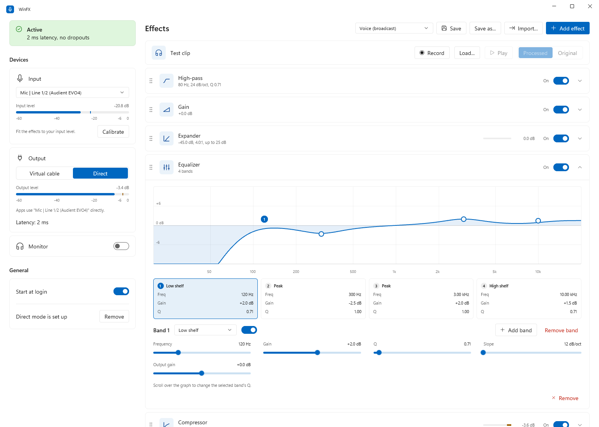

<p align="center">
  
</p>

<h1 align="center">WinFX</h1>

<p align="center">
  Real-time effects for your microphone on Windows.<br>
  Build a chain of effects, hear what each one does, and every app that uses your mic gets the processed sound.
</p>

<p align="center">
  <a href="../../releases/latest">Download</a> ·
  <a href="#getting-started">Getting started</a> ·
  <a href="#troubleshooting">Troubleshooting</a> ·
  <a href="#building-from-source">Building</a>
</p>

<picture>
  <source media="(prefers-color-scheme: dark)" srcset="docs/screenshot-dark.png">
  
</picture>

## Features

- **Dynamics:** gate, expander, compressor, de-esser, auto-gain, maximizer, limiter
- **Tone:** high-pass and low-pass filters, a parametric EQ (up to 32 bands) over a live spectrum, exciter, bass enhancer, convolver for impulse responses
- **Fun:** pitch shift, harmonizer, autotune, reverb, delay, bit crusher
- **Tuning tools:** record a test clip and loop it through the chain, switching between processed and original; one-click calibration that fits gain and gate thresholds to your mic and room
- **Presets:** three starters to build from, your own presets, and import from EasyEffects (`.json`) and Equalizer APO or AutoEQ (`.txt`)
- **Low latency:** in direct mode the effects run inside the Windows audio engine, adding only the limiter's look-ahead (a millisecond or two)
- **Native look:** Fluent design with Mica, light and dark themes that follow Windows, a tray icon, and start at login
- **Offline:** no account, no telemetry, no update checks

WinFX is inspired by [EasyEffects](https://github.com/wwmm/easyeffects) on Linux.

## Getting started

Requires Windows 10 (version 1809) or later on x64. WinFX is developed and tested on Windows 11.

1. Download the installer from the [latest release](../../releases/latest) and run it. It installs for your account only and doesn't need admin rights.

   > The installer isn't code-signed yet, so Windows SmartScreen may warn you about it. Select **More info**, then **Run anyway**.

2. Open WinFX and choose your microphone under **Input**.
3. Under **Output**, choose **Direct** and select **Set up**. Windows asks for permission once, and audio restarts briefly.
4. Select **Calibrate** in the Input card. Stay quiet for 4 seconds, then speak normally for 5. WinFX sets the gain and gate thresholds to suit your mic.
5. Pick a preset and adjust it to taste. Use **Test clip** to record yourself and hear the changes on a loop.

Your apps keep using your microphone as usual and receive the processed sound. Closing the window keeps WinFX in the tray.

## Output modes

### Direct (recommended)

The effects run inside the Windows audio engine, on the microphone itself. Every app that records the mic gets the processed sound, with nothing to reconfigure and no extra latency beyond the limiter's look-ahead (a millisecond or two).

- **One-time setup per device**, from the Output card. It needs admin rights once, because the audio engine is shared by all users of the PC.
- **Audio enhancements must be on** for the device (Settings > System > Sound > your input > Audio enhancements). WinFX tells you if they're off and can turn them back on.
- **Keeps running without WinFX.** The effects carry on with the last chain you set, even after you quit the app.
- **Undo it** with **Remove** in the General card. This restores the device's own audio enhancements.

Some audio interfaces create a separate set of Windows devices for each sample rate. WinFX sets up all of them, and attaches to new ones as they appear while it's running.

### Virtual cable

WinFX records your mic, processes it, and plays the result into a virtual audio cable such as [VB-Audio Virtual Cable](https://vb-audio.com/Cable/). Your apps then record from the cable ("CABLE Output") instead of the mic.

Use this mode when direct mode isn't an option:

- your device's driver doesn't load Windows audio enhancements
- you can't get admin rights for the one-time setup
- you want the raw mic and the processed sound available at the same time, for example to record the raw mic while streaming the processed one

It adds the cable's latency, usually a few milliseconds. With VB-Cable, set its latency to 3 × 256 samples or more in its control panel; smaller values can produce silence.

## Troubleshooting

**The status says "Not processing".**
Check that direct mode is set up for the selected input, and that Windows audio enhancements are on for it. WinFX shows a button for whichever is missing.

**One app hears the raw mic.**
That app opens the mic in exclusive mode, which skips Windows audio enhancements. Turn exclusive mode off in the app's audio settings, or turn off **Allow applications to take exclusive control of this device** in the mic's properties (Sound Control Panel > Recording > your mic > Properties > Advanced).

**The effects stopped after changing the sample rate.**
Your interface probably created new Windows devices for the new rate. Open WinFX; it attaches to new devices while it's running. If the status still says "Not processing", select **Set up** again.

**Silence in virtual cable mode.**
Raise VB-Cable's latency to 3 × 256 samples or more, and make sure your app records from "CABLE Output".

**Reporting a bug.**
[Open an issue](../../issues/new/choose) and attach the logs:

- `%LOCALAPPDATA%\winfx\winfx.log` (the app)
- `%ProgramData%\WinFX\apo.log` (direct mode)

## Uninstalling

Uninstall WinFX from Settings > Apps > Installed apps. If direct mode is set up, Windows asks for permission to remove it from the audio engine.

Your settings and presets stay in `%APPDATA%\winfx`. Delete that folder to remove them too.

## Building from source

You need Rust (stable, MSVC toolchain) and the Windows SDK.

```
cargo build --release
cargo test --workspace
```

This produces `target\release\winfx.exe` and `target\release\winfx_apo.dll`. The DLL is the direct-mode plug-in and must sit next to the exe.

To build the installer, install [Inno Setup 6](https://jrsoftware.org/isinfo.php) and `cargo install cargo-about --features cli`, then run `tools\build-release.ps1`. The installer lands in `dist\`.

### Project layout

| Path | What it is |
|---|---|
| `crates/engine` | Audio I/O (WASAPI), the effects, presets and import, and direct-mode setup and shared memory |
| `crates/app` | The WinFX app, built with [GPUI](https://www.gpui.rs/) |
| `crates/apo` | `winfx_apo.dll`, the audio processing object that runs the chain inside the Windows audio engine |
| `installer` | The Inno Setup script |
| `tools` | Release build script, icon generator, and `apo-dev`, scripts for developing the plug-in without repeated admin prompts |

Useful examples: `cargo run -p engine --example run -- --list` runs the engine without the app, `--example analyze` compares presets on a recording, and `--example apo_ctl` drives the direct-mode plug-in.

See [CONTRIBUTING.md](CONTRIBUTING.md) before opening a pull request.

## License

MIT. See [LICENSE](LICENSE). The installer includes `THIRD-PARTY-NOTICES.html` with the licenses of the libraries WinFX uses.
